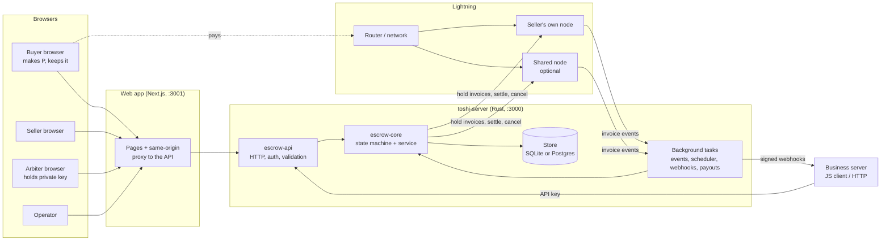
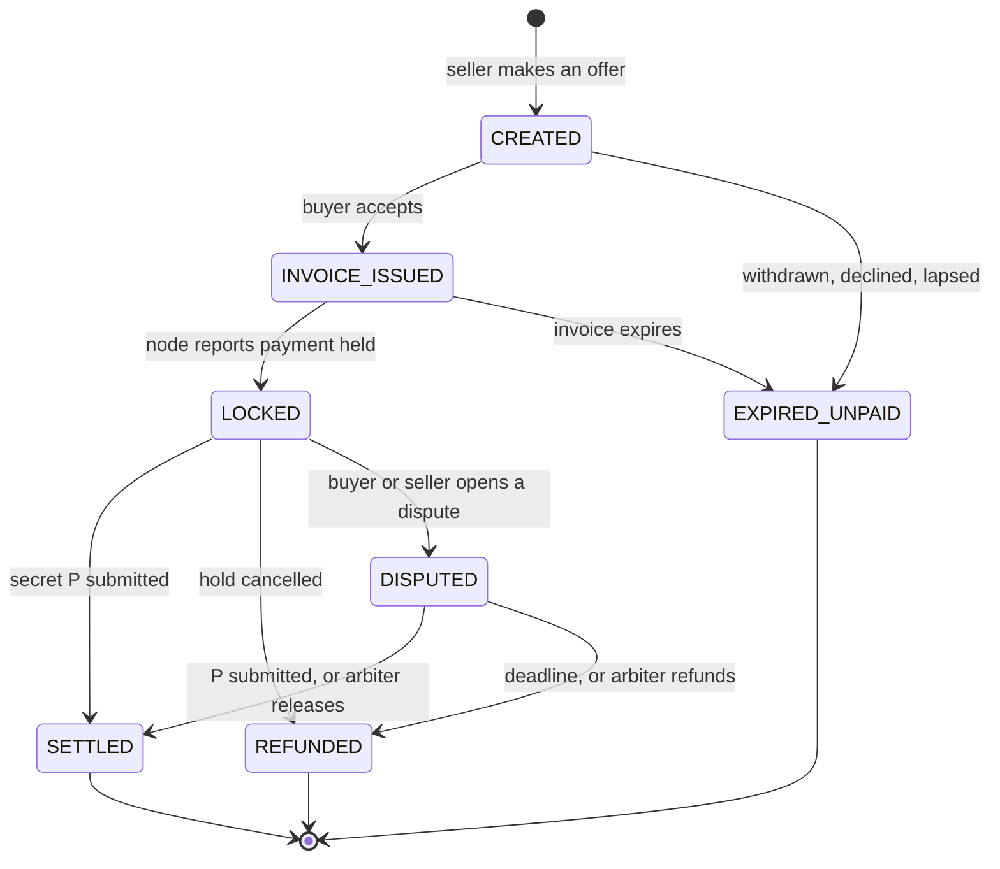

# toshi-way: architecture

How the system is put together, and why. Written for an engineer reading this codebase for the first time. For what the product does and how to use it, see the [README](../README.md), [`project.md`](project.md) (spec and trust model) and [`api.md`](api.md) (the business-facing API). [`flow.md`](flow.md) is the dated log of decisions and measurements behind what is described here.

Everything runs on Bitcoin **regtest** (a local test network). No real money is involved.

## 1. The idea in one paragraph

A buyer's payment is **locked** on the Lightning network instead of sent. The seller's node issues a *hold invoice* for a hash `H`; the buyer pays it; the payment is committed but not settled. It is released to the seller when someone submits the secret `P` where `H = sha256(P)`, and refunded automatically when a deadline passes. The escrow *is* the lock: the service never holds the money in flight. The one rule that shapes the whole design is that **escrow state comes from the node, never from a client's claim**.

## 2. System at a glance



Three things to take from the picture:

- **The browser does the cryptography.** The buyer's secret `P` is generated in their browser and never leaves it in the clear (§6).
- **The server is a coordinator, not a wallet.** It tells the node what to do and records what the node reports.
- **The web app is the only thing a person's browser talks to.** It proxies `/api/v1/*` to the server, so one forwarded port (a Codespace, an ngrok tunnel) is enough.

## 3. Repository layout

| Path | What it is | Depends on |
|---|---|---|
| [`escrow-core/`](../escrow-core) | State machine, timing rules, the escrow **service**, domain model, and the *traits* everything else implements. No I/O: no node, no database, no web server. | nothing in the workspace |
| [`escrow-lnd/`](../escrow-lnd) | LND adapter, the per-seller **node directory**, credential sealing, and the **runners** (event loop, deadline scheduler, payout loop). | core |
| [`escrow-sqlite/`](../escrow-sqlite), [`escrow-postgres/`](../escrow-postgres) | The two storage backends, with migrations. Both pass one shared contract test. | core |
| [`escrow-api/`](../escrow-api) | The HTTP API (Axum), authentication, rate limiting, webhooks, money endpoints, and the `toshi-server` binary that wires it all together. | core, lnd, sqlite, postgres |
| [`web/`](../web) | The Next.js app (App Router, React 19, Tailwind). | the HTTP API only |
| [`sdk/js/`](../sdk/js) | A dependency-free JavaScript client for businesses, plus a Next.js example shop. | the HTTP API only |
| [`regtest/`](../regtest) | Docker Compose Lightning test network: bitcoind, buyer, router, two sellers. | |
| [`scripts/`](../scripts) | `demo-env.sh` (one-command environment), seeding, a demo wallet, a curl walkthrough. | |
| [`phase1/`](../phase1) | The original proof that the hold-invoice cycle works on regtest. Kept as a reference; not part of the running system. | |

The dependency direction is strict: `core` knows nothing about LND, SQL or HTTP. That is what makes the state machine testable with a mock node and an in-memory store, and the backends interchangeable.

## 4. The core (`escrow-core`)

### 4.1 State machine

States: `CREATED`, `INVOICE_ISSUED`, `LOCKED`, `SETTLED`, `REFUNDED`, `EXPIRED_UNPAID`, `DISPUTED`, `FAILED`. Allowed moves live in [`state.rs`](../escrow-core/src/state.rs) (`can_transition_to`):



Any non-terminal state can also move to `FAILED` (an unrecoverable mismatch that needs the operator). `SETTLED` and `REFUNDED` are terminal. **If the escrow's state and the node's state disagree, the node wins.**

### 4.2 Traits: the seams

| Trait | Defined in | Implemented by | Why it exists |
|---|---|---|---|
| `LightningAdapter` | `adapter.rs` | `LndAdapter` (real), `MockLightning` (tests) | Create hold invoices, settle, cancel, read invoice state. Settle and cancel are idempotent. |
| `NodeDirectory` | `adapter.rs` | LND directory (`escrow-lnd/directory.rs`) | Finds *which node* serves a seller: their own, or the shared one. The service asks it for every node call. |
| `Store` | `store.rs` | `MemoryStore`, `SqliteStore`, `PostgresStore` | Escrows and their audit log. **Every change is a compare-and-set on the state, written with its audit entry in one transaction.** |
| `UserStore` | `store.rs` | same three | Users, token hashes, API keys, webhooks, arbiter keys, withdrawal PINs. |
| `PayoutStore` | `store.rs` | same three | Balances and withdrawals (the money ledger for shared-node sellers). |
| `Wallet`, `RampProvider` | `payout.rs`, `ramp.rs` | LND wallet, a labelled **demo** naira provider | Paying sellers out; converting naira to and from sats. |

### 4.3 The service

[`EscrowService`](../escrow-core/src/service.rs) is the only thing that changes escrow state. Handlers in the API never do. Its main operations: `create`, `accept` (stores the buyer's hash `H`, asks the node for a hold invoice), `apply_event` (the node says an invoice changed), `release` (settle with `P`), `cancel`, `dispute`, `add_note`, `confirm_arbiter`, `arbitrate`, `tick` (the deadline pass), and `reconcile` (bring state in line with the node).

Two properties are worth knowing before changing anything here:

- **Compare-and-set transitions.** `Store::transition(id, expected, update, audit)` fails with `Conflict` if the escrow is no longer in `expected`. Two actors racing (the scheduler and a release, say) cannot both win. Same-state entries (a note, an arbiter's confirmation) use the same call with `from == to`.
- **The audit log is the history.** Each change writes an `AuditEntry` (actor, action, from, to, reason, time). The timeline in the UI, the webhook feed and the arbiter's evidence view are all built from it.

### 4.4 Time

[`timing.rs`](../escrow-core/src/timing.rs) holds the deadline rules: hold length limits (60 seconds to 6 hours), how long an unpaid invoice stays payable (10 minutes), and the conversion of a wall-clock deadline into a block-based expiry for the hold invoice. Lightning counts time in blocks, so the conversion assumes 10 minutes per block and keeps a **safety margin of 6 blocks** between our deadline and the node's own auto-cancel, so our scheduler always acts first. All times are unix seconds; the clock is injected (`Arc<dyn Fn() -> i64>`) so tests control it.

## 5. The server (`escrow-api`, `escrow-lnd`)

### 5.1 Startup ([`main.rs`](../escrow-api/src/main.rs))

`toshi-server` reads its configuration from the environment (§10), opens the store, connects the optional shared node and wallets, builds the `EscrowService` and the Axum router, then spawns the background tasks and serves HTTP.

### 5.2 Request handling

Handlers in [`routes.rs`](../escrow-api/src/routes.rs) and [`money.rs`](../escrow-api/src/money.rs) do four things and nothing else: **authenticate**, **authorize against the escrow's party**, **validate input**, and **call the service**. They never decide payment state.

- **Authentication** ([`auth.rs`](../escrow-api/src/auth.rs)). Three credentials: an *account token* (`tw_…`, stored only as a hash), an *API key* (`tk_…`, scoped `escrows:read` / `escrows:write`, revocable, can never touch the node, account, webhooks or anything a buyer or arbiter does), and the *operator token* from the environment.
- **Parties.** For each escrow the caller is a `Buyer`, `Seller`, `Arbiter` or `Operator`; what they may do follows from that. A stranger gets `404`, not `403`, so an escrow's existence is not leaked.
- **Rate limiting** ([`ratelimit.rs`](../escrow-api/src/ratelimit.rs)), per caller (or per address when anonymous), with a stricter limit on sign-ups.
- **Idempotency.** `POST /escrows` honours an `Idempotency-Key`; the cache is in memory and forgets on restart.
- **Errors** are `{ "error": { "code", "message" } }`; clients branch on `code`.

The route table is the best map of what exists: see `router()` in [`lib.rs`](../escrow-api/src/lib.rs). Roughly: users and keys, rates, escrow lifecycle (`create`, `accept`, `invoice`, `release`, `cancel`, `dispute`, `notes`, `events`), arbitration (`arbitration`, `confirm`, `decide`, `arbiter/default`), webhooks, balances and withdrawals, and the naira ramp.

### 5.3 Background tasks

All are spawned in `main.rs` and run for the life of the process.

| Task | Where | What it does |
|---|---|---|
| **Event loop** | `escrow-lnd/runner.rs` | Keeps one watcher per open escrow on its node, feeds each invoice change into `apply_event`, **reconciles at startup and every 30 s** as a safety net, resubscribes with backoff when a stream drops. |
| **Scheduler** | `runner.rs` | Calls `tick` every second: cancels holds at their deadline, unpaid invoices when they expire, offers nobody accepted. This is what makes the refund path need no human. |
| **Webhook dispatcher** | `escrow-api/webhooks.rs` | Reads the audit feed from a stored cursor, signs each event (HMAC-SHA256 over `t.body`), delivers to the seller's endpoints, retries with growing waits, and **keeps order**: a failing event blocks later ones for that endpoint. |
| **Payout loop** | `runner.rs` | Every 2 s settles Lightning withdrawals and moves naira orders along from what the node reports. |

### 5.4 Whose node?

[`NodeDirectory`](../escrow-core/src/adapter.rs) lets one server serve many sellers:

- **Own node** (Mode A, the default aim). The seller connects their LND (address, TLS cert, an *invoice-only* macaroon, stored encrypted with `NODE_CREDENTIAL_KEY`). Escrows are issued on it and a release pays them directly. Nobody else holds the money.
- **Shared node** (optional, `SHARED_NODE=on`). The service's own LND receives the sats on release and owes them to the seller, who withdraws from a **balance**. This is custodial and is labelled as such in the product. `SHARED_NODE=off` makes every seller bring their own.

A seller can only change their node while none of their escrows is in flight on it.

## 6. Trust and security model

The server is deliberately unable to take or release money by itself.

| Secret | Made where | Kept where | Who can see it |
|---|---|---|---|
| **`P`**, the release secret | Buyer's browser (256 random bits) | Buyer's `localStorage`; shown as a QR at handover | The server sees it **once**, in the release call, and passes it to the node. There is **no column for it** in either database. |
| **Account token** | Server, at sign-up | Encrypted on the device by a password-derived key (PBKDF2-SHA-256, 600k iterations, AES-256-GCM) | The server stores only its hash. There is no server-side reset. |
| **Seller's node macaroon** | Seller's node | Server, encrypted at rest | Invoice-only: it cannot spend. |
| **Arbiter's private key** | Arbiter's browser | That browser (with backup/restore) | Only the arbiter. |
| **Webhook signing secret** | Server | Sealed at rest | Shown once to the business. |
| **Withdrawal PIN** | The seller | Argon2 hash; 5 wrong guesses lock it for 15 minutes; a new or changed PIN waits 24 hours before it can authorise a withdrawal | Only the seller. |

Consequences worth keeping in mind when changing things:

- A client's claim never changes escrow state. State changes come from node events or from checked actions (`release` verifies `sha256(P)` against the stored hash).
- The scheduler guarantees a refund if nothing happens before the deadline. Every flow must still be correct if it fires at any moment.
- Anything that could pay out shared-node money is rate-limited, PIN-protected, capped per 24 hours, and held for 24 hours when the payment came from a naira transfer (a bank transfer can be reversed).

### Arbitration

When an escrow has an **arbiter**, the buyer's browser also encrypts `P` to the arbiter's public key (ECDH P-256 + HKDF-SHA-256 + AES-256-GCM) and uploads only the ciphertext. The server cannot read it. The arbiter's browser opens it, checks `sha256(P)` equals the payment hash, and **confirms**, so the seller knows arbitration is real. After a dispute the arbiter chooses *release* (sending the opened `P`) or *refund* (cancelling the hold). The arbiter's key is recorded on the escrow at creation so it cannot be swapped later.

- The arbiter can decide only while the escrow is `DISPUTED` and before the deadline. A hold cannot be extended: after the deadline the buyer is refunded.
- **Response window.** After a dispute opens, the other side gets a quarter of the remaining time (at most an hour) before an arbiter may decide, ending early the moment they add a note. Deciding sooner is `409 response_window`.
- **Platform arbiter.** If `PLATFORM_ARBITER_ID` names an ordinary account that has registered an arbiter key, escrows whose seller names no arbiter get it. Its key stays in a person's browser, so the server still cannot release anything alone; the cost is that a person confirms and decides by hand.
- **Evidence.** Either party can add `delivered` and `evidence` notes while the money is locked. They are audit entries, move no money and do not extend the deadline.

## 7. Persistence

- **Two backends, one contract.** `escrow-core/src/testing.rs` holds the contract tests (`store_contract`, `history_contract`, `user_store_contract`, `payout_store_contract`); memory, SQLite and Postgres all run them. Anything a backend must guarantee is asserted there.
- **Migrations** are `.sql` files in each backend, applied in order and never edited afterwards: SQLite tracks them with `PRAGMA user_version`, Postgres with a `schema_migrations` table and an advisory lock so several instances can start safely. Adding a column means one new migration in **each** backend plus the row-mapping, insert and update code.
- **What is stored:** escrows, the audit log, node events, users and token hashes, API keys, webhook endpoints and their delivery cursor, arbiter keys, withdrawal PINs, balances and withdrawals, naira orders.
- SQLite is the default (`DATABASE_PATH`); setting `DATABASE_URL` selects Postgres.

## 8. The web app (`web/`)

A Next.js App Router app. The browser holds the user's secrets, so a lot of logic is client-side.

- **Pages** (`app/`): `/` (landing for visitors, dashboard when signed in), `/escrows/new`, `/escrows/[id]`, `/node`, `/arbiter`, `/balance`, `/developers` (API keys, webhooks, first call), `/account` (profile, security, backup), `/operator`.
- **Shell** ([`AppShell.tsx`](../web/components/AppShell.tsx), `Sidebar.tsx`): a dark sidebar for signed-in pages; the landing page brings its own chrome. The page element stays mounted across the landing/app switch so the one-time "save your token" screen survives sign-up.
- **`lib/`** holds the parts that must run in the browser: `secret.ts` (makes `P` and its hash, stores it), `arbiter.ts` (key pairs, sealing and opening), `vault.ts` and `session.ts` (the encrypted account), `backup.ts`, `webln.ts` (one-click wallet payment), `scan.ts` (camera QR), `api.ts` (every API call, validated with **zod** schemas from `schemas.ts`), `dashboard.ts` (what is "yours to do"), `lifecycle.ts`, `clock.ts` (server-clock correction for countdowns).
- **Escrow page** (`components/escrow/`): one component per role (`BuyerPanel`, `SellerPanel`, `ArbiterPanel`, `OperatorPanel` in `panels.tsx`), a `Timeline` built from the audit log, and `Notes.tsx` for delivery claims and evidence. The page polls the escrow and refetches its history when `updated_at` changes.
- **Proxy.** `next.config.ts` rewrites `/api/v1/*` (and `/health`) to the server when `API_PROXY_TARGET` is set, and the app is started with `NEXT_PUBLIC_API_URL=""` so the browser uses relative URLs. No CORS, one port to expose.
- **Privacy defaults.** Pages are `noindex`, `referrer: no-referrer` (the release secret can sit in a URL fragment), and the secret is removed from the address bar as soon as it is read.

## 9. The business client (`sdk/js`)

A small ES-module client with no dependencies (Node 18+): `Toshi` (`create`, `get`, `list`, `events`, `note`, `cancel`, `waitFor`), `verifyWebhook`, and typed errors. It retries reads and idempotent creates on network errors, `429` and `502/503/504`, and **never** retries `cancel` or `note` by itself. [`examples/nextjs-shop`](../sdk/js/examples/nextjs-shop) is a complete shop: checkout route, a webhook route that verifies the raw body and handles each event once, and an order page.

## 10. Configuration

`toshi-server` (environment variables; defaults suit local regtest):

| Variable | Meaning |
|---|---|
| `OPERATOR_TOKEN` | Required, ≥ 24 characters. The operator's credential. |
| `BIND` | Listen address, default `127.0.0.1:3000`. |
| `DATABASE_PATH` / `DATABASE_URL` | SQLite file, or a Postgres URL (which wins). |
| `SHARED_NODE` | `on` (default) or `off`. With `LND_ADDR`, `LND_TLS_CERT`, `LND_MACAROON` for the shared node. |
| `NODE_CREDENTIAL_KEY` | Seals sellers' node credentials and webhook secrets. Webhooks and own nodes need it. |
| `ALLOW_PRIVATE_NODE_ADDRESSES` | `1` to let sellers connect nodes on private addresses (local testing only). |
| `PAYOUT_MACAROON` | A macaroon allowed to send payments, to enable shared-node withdrawals. |
| `RAMP_PROVIDER`, `RAMP_LND_*`, `RAMP_FEE_BPS` | The naira ramp (`off` or the labelled `demo` provider). |
| `NAIRA_HOLD_HOURS`, `WITHDRAW_LIMIT_SATS`, `PIN_COOLOFF_HOURS` | Withdrawal safety limits (24 h, 1,000,000 sats and 24 h by default). `PIN_COOLOFF_HOURS` is how long a new or changed PIN waits before it works, so a stolen sign-in cannot set a PIN and withdraw at once. |
| `FIAT_PROVIDER` | `off`, `coingecko`, `mempool`, or `fixed:USD=65000,NGN=…` (labelled "demo rate"). |
| `PUBLIC_WEB_URL` | The web app's public address, so the API can return `checkout_url`. |
| `PLATFORM_ARBITER_ID` | An account that acts as arbiter when a seller names none. |
| `RATE_LIMIT_PER_MIN`, `REGISTER_LIMIT_PER_MIN`, `CORS_ORIGINS` | Request limits and allowed browser origins. |

Web app: `NEXT_PUBLIC_API_URL`, `API_PROXY_TARGET`, `DEMO_WALLET_TARGET`, `NEXT_PUBLIC_DEMO_WALLET_URL`, `NEXT_PUBLIC_APP_URL`.

## 11. Running it locally

```bash
./scripts/demo-env.sh up        # regtest network, server, web app, demo wallet, seeded accounts
./scripts/demo-env.sh status    # what is running, and each node's balance
./scripts/demo-env.sh down      # stop the server, wallet and web app (the network keeps running)
./scripts/demo-env.sh repair    # wipe the regtest network and demo state when Docker comes back broken
```

State lives in `.demo/` (gitignored). `regtest/docker-compose.yml` runs bitcoind and four LND nodes (buyer, router, seller, seller2); an optional `postgres` profile adds a database for the Postgres tests.

## 12. Testing

| What | How | Needs |
|---|---|---|
| Rust unit and integration tests | `cargo test --workspace` | nothing; mock node and in-memory store |
| Store contract on real SQL | included above (SQLite); `cargo test -p escrow-postgres -- --ignored --test-threads=1` | the `postgres` Compose profile |
| LND adapter | `cargo test -p escrow-lnd -- --ignored --test-threads=1` | the regtest network |
| Web unit tests, lint, build | `cd web && npm test && npm run lint && npm run build` | nothing |
| JavaScript client | `cd sdk/js && npm test` | nothing |
| Browser end to end | `cd web && npm run e2e` | the full stack from `demo-env.sh up` |
| Scripted demo | `cd web && npm run rehearse` | the full stack |

Notes: the e2e suite runs against whatever server is up, so tests that need a particular server setting (the platform-arbiter test needs `PLATFORM_ARBITER_ID`) skip themselves otherwise. Postgres tests are `#[ignore]` by default and are not run by `cargo test --workspace`.

## 13. Extending it

- **A new escrow action.** Add a method to `EscrowService` (with its audit entry), a handler in `routes.rs` that only authenticates, authorizes and validates, a route in `router()`, a function and zod schema in `web/lib`, and a test at the service level and over HTTP.
- **A new stored field.** A migration in both `escrow-sqlite` and `escrow-postgres`, the model field, `EscrowUpdate`, the memory store, both SQL stores (select list, row mapping, insert, update), the API view, and the contract test. `delivered_at` is a recent, small example to copy.
- **A new storage backend.** Implement `Store`, `UserStore` and `PayoutStore`, and run the contract tests from `escrow-core/src/testing.rs`.
- **A different Lightning node.** Implement `LightningAdapter` (and `Wallet`); the service and runners are generic over it.
- **A real naira provider.** Implement `RampProvider`; the demo provider is the reference.

## 14. Known limits

Stated plainly, as in the rest of the docs:

- **Regtest only.** Nothing has run against real money.
- **Holds are at most 6 hours.** That is too short for shipments, vehicles or property; longer holds need a look at how long the network will carry a held payment.
- **No hold extension.** A dispute does not stretch the deadline, so an arbiter must decide in time.
- **Idempotency keys are in memory** and forgotten on restart.
- **Webhooks go to the seller's side only,** at least once, in order per endpoint. There is no buyer or arbiter feed and no way to replay missed events.
- **Platform arbitration is manual:** one person's browser holds the key, and each escrow needs confirming by hand.
- **The shared node is custodial** for the time between release and withdrawal.
- **Evidence is text only,** up to 500 characters per note.
